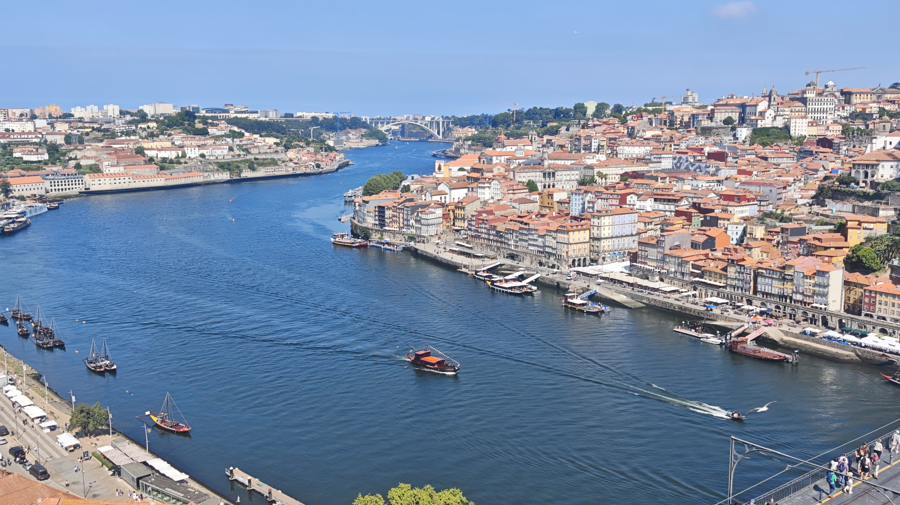
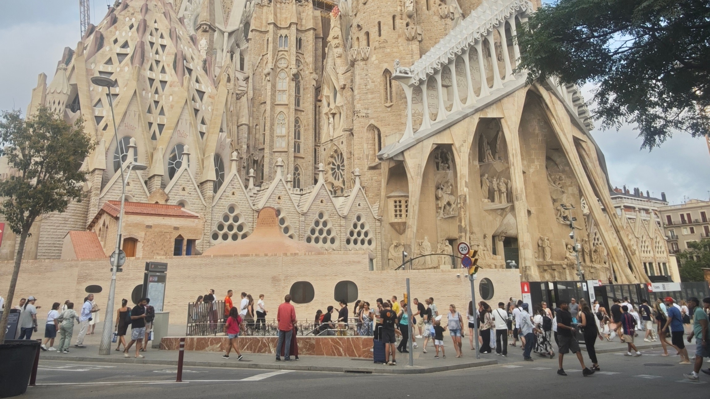
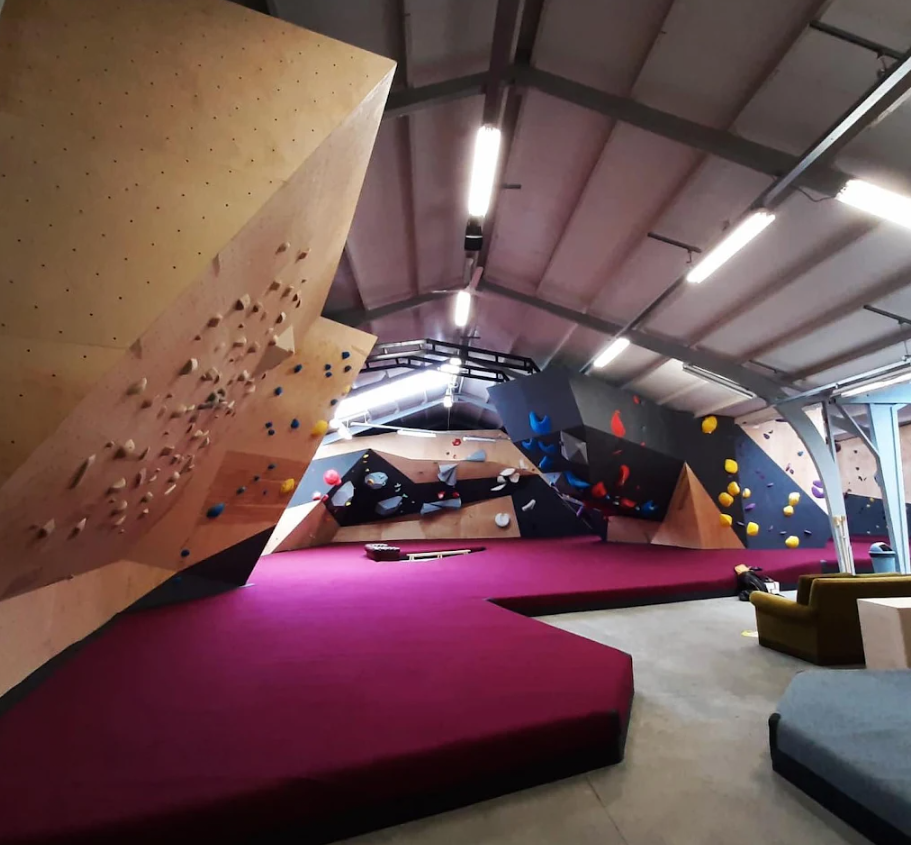
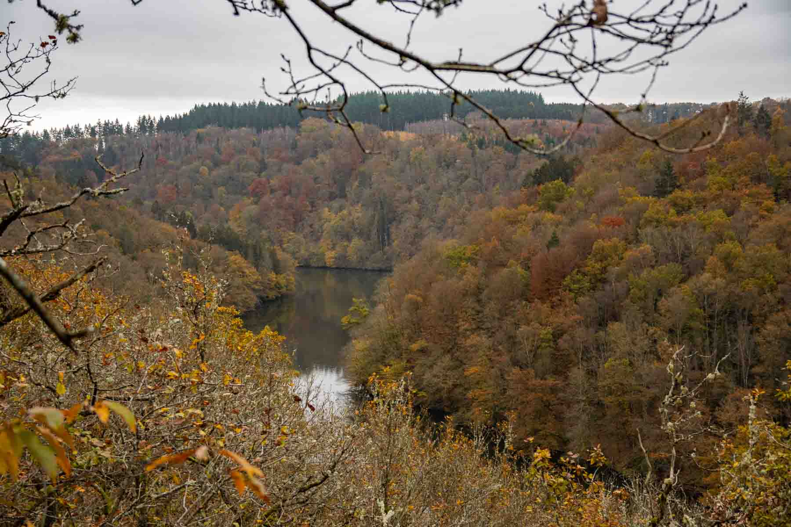
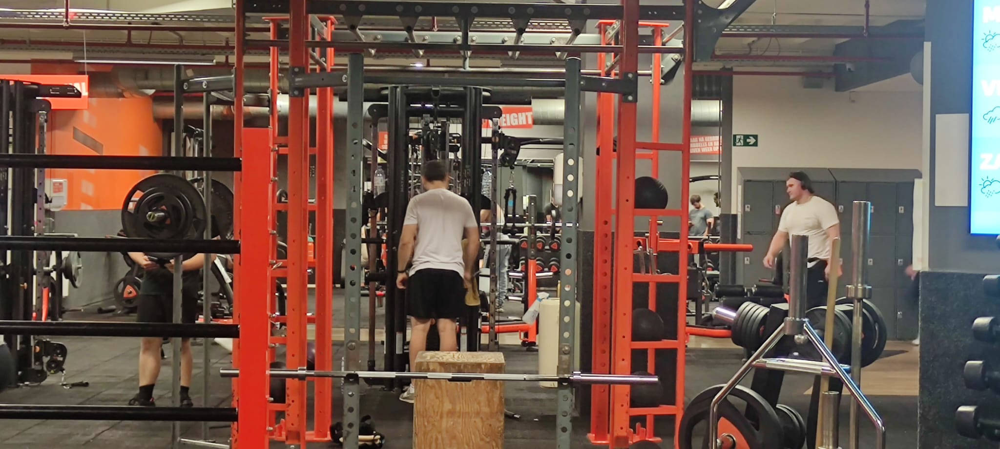

## Through My Lens: Travel & Photography

  

    
  

  

    
    

      
Capturing the world

    

  

  

    
  

## The Great Outdoors: Climbing & Hiking

Every trail hiked and every wall climbed is a new perspective gained.

  

    
  

  

    

      
    

    

      
    

  

## Balancing Mind & Body: Chess, Art, and Fitness

Beyond academia, I believe in cultivating both a resilient body and a sharp mind. You will often find me pushing my physical limits through **fitness training** or out on a **hiking** trail, breathing in the fresh air and resetting my focus. 

When I'm indoors, my energy shifts to quieter, more introspective pursuits. I have a deep appreciation for **Chinese Chess (Xiangqi)**—a brilliant game of strategy, foresight, and patience that often mirrors the problem-solving processes in my research. Alongside chess, **drawing and painting** offer me a creative outlet, allowing me to express ideas visually and find tranquility through art. It's this balance between physical exertion and mental stillness that keeps me grounded.

"Research sharpens the intellect, but the combination of nature, strategy, and art nourishes the soul."

Logic on the board, creativity on the canvas.

<!-- 

   -->

