# About Me

Here is **Xiaowei Wu**. 

I am a Ph.D. Candidate in the Department of [Materials Engineering](https://mtm.kuleuven.be/english) at the [Metal Performance Innovation (Elooi) Laboratory](https://www.mtm.kuleuven.be/english/research/elooi/) of the **KU Leuven**. Currently, I build **data-driven approaches and computational models** for dented thin sheet metals, spanning 3D surface metrology (point-cloud segmentation and parametric modelling), mechanical response simulation with **Finite-Element Analysis**, structural integrity assessment, and **Machine Learning** for remaining useful life prediction. Broadly, my interests lie at the intersection of **fatigue and fracture mechanics, impact dent damage, structural integrity, numerical simulation and machine learning**. Prior to joining KU Leuven, I gained valuable research experiences as a Master's student at Harbin Institute of Technology advised by [Prof. Xiaoguo Song](https://scholar.google.com/citations?user=XIiWmtIAAAAJ&hl=zh-CN). My work focused on **ultrasonic-assisted active-metal soldering**, **interfacial characterisation**, and **dissimilar-material processing**. I developed and analyzed advanced heat-treatment processes, conducted extensive microstructural characterisations, and applied these techniques to structural composite materials, resulting in four journal publications and one granted patent. 

## Work Experience

  

  

    

      
    

    

      

        
Ph.D. Candidate | KU Leuven

        Mar. 2023 - Jan. 2027
      

      

        Developed an inspection-driven framework connecting 3D dent morphology to local mechanical states and fatigue performance through parametric geometry descriptors. Built finite-element models and established machine learning models for residual-stress assessment and remaining-useful-life prediction.
      

    

  

  

    

      
    

    

      

        
Master's Researcher | Harbin Institute of Technology

        Sep. 2020 - Sep. 2022
      

      

        Investigated the bonding mechanism and process-property relationship of ultrasound-induced low-temperature active-metal soldering of quartz glass using Sn-Ti alloy. Characterised interfacial reactions and microstructural evolution.
      

    

  

  

    

      
    

    

      

        
Undergraduate Researcher | Taiyuan University of Technology

        Aug. 2018 - Jun. 2020
      

      

        Fabricated copper-steel composite sheets via friction-stir additive manufacturing and characterised the dissimilar-material interface. Developed a heat-treatment route for NiTi alloy with controllable dual-memory effect and designed a support structure using finite-element analysis.
      

    

  

  

    

      
    

    

      

        
Formula Student Intern | HENREY AUTOMOBILE

        Jul. 2018 - Aug. 2018
      

      

        Served as a Formula Student car-body intern, responsible for schedule coordination, small-assembly design, and technical training.
      

    

  

If you are interested in any aspect of me, I am always open to discussions and collaborations. Feel free to reach out to me at - xiaowei.wu@kuleuven.be

**Seeking Materials/Mechanical Engineering roles — Fatigue & Fracture Mechanics, 3D Metrology, and Predictive Modeling. Feel free to reach out!**

---

## Publications

<h3 class="section-title">Journal Publications</h3>

  

    

      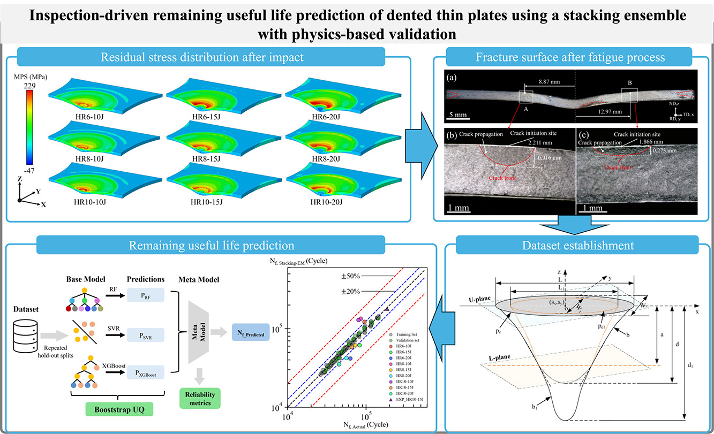
      <a href="https://doi.org/10.1016/j.ijfatigue.2026.109837" class="publication-overlay" target="_blank" rel="noopener">
        View Paper
      </a>
    

    

      

        <a href="https://doi.org/10.1016/j.ijfatigue.2026.109837" target="_blank" rel="noopener">Inspection-driven remaining useful life prediction of dented thin plates using a stacking ensemble with physics-based validation</a>
      

      
<strong class="author-highlight">Xiaowei Wu</strong>, Sanjay Gothivarekar, Reza Talemi

      
International Journal of Fatigue, 2026 <a href="https://doi.org/10.1016/j.ijfatigue.2026.109837" target="_blank">[paper]</a>

      
SCI, first author

    

  

  

    

      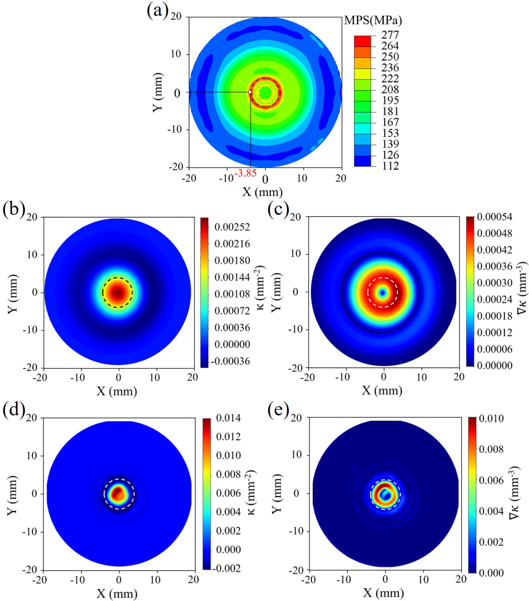
      <a href="https://doi.org/10.1016/j.aei.2026.104656" class="publication-overlay" target="_blank" rel="noopener">
        View Paper
      </a>
    

    

      

        <a href="https://doi.org/10.1016/j.aei.2026.104656" target="_blank" rel="noopener">Quantitative stress assessment of dented fuselage panels through the integration of FEM, parametric modeling and Gaussian process regression</a>
      

      
<strong class="author-highlight">Xiaowei Wu</strong>, Sanjay Gothivarekar, Reza Talemi

      
Advanced Engineering Informatics, 2026 <a href="https://doi.org/10.1016/j.aei.2026.104656" target="_blank">[paper]</a>

      
SCI, first author

    

  

  

    

      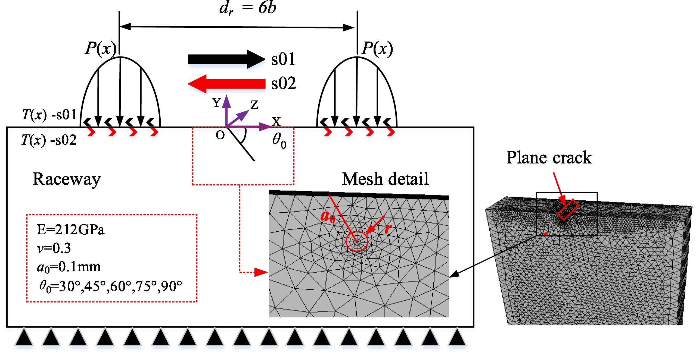
      <a href="https://doi.org/10.1016/j.engfailanal.2024.108839" class="publication-overlay" target="_blank" rel="noopener">
        View Paper
      </a>
    

    

      

        <a href="https://doi.org/10.1016/j.engfailanal.2024.108839" target="_blank" rel="noopener">Analysing crack evolution in wind turbine bearings using an oscillation-unified model</a>
      

      
S. Wang, J. Du, C. Li, S. Jiang, <strong class="author-highlight">Xiaowei Wu</strong>, Reza Talemi

      
Engineering Failure Analysis, 2024 <a href="https://doi.org/10.1016/j.engfailanal.2024.108839" target="_blank">[paper]</a>

      
SCI, co-author

    

  

  

    

      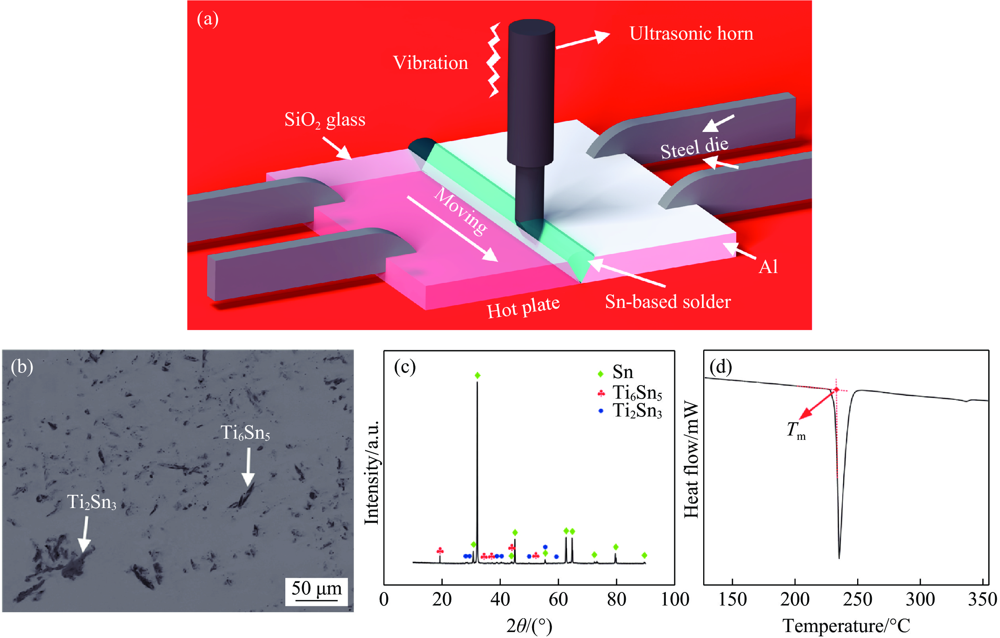
      <a href="https://doi.org/10.12073/j.cw.20230308001" class="publication-overlay" target="_blank" rel="noopener">
        View Paper
      </a>
    

    

      

        <a href="https://doi.org/10.12073/j.cw.20230308001" target="_blank" rel="noopener">Bonding mechanisms of SiO2 glass and 1060 Al by ultrasonic assisted active metal soldering process</a>
      

      
<strong class="author-highlight">Xiaowei Wu</strong>, J. Fu, S. Wei, H. Dong, J. Wang, H. Wang, Xiaoguo Song, Z. Li

      
China Welding, 2023 <a href="https://doi.org/10.12073/j.cw.20230308001" target="_blank">[paper]</a>

      
first author

    

  

  

    

      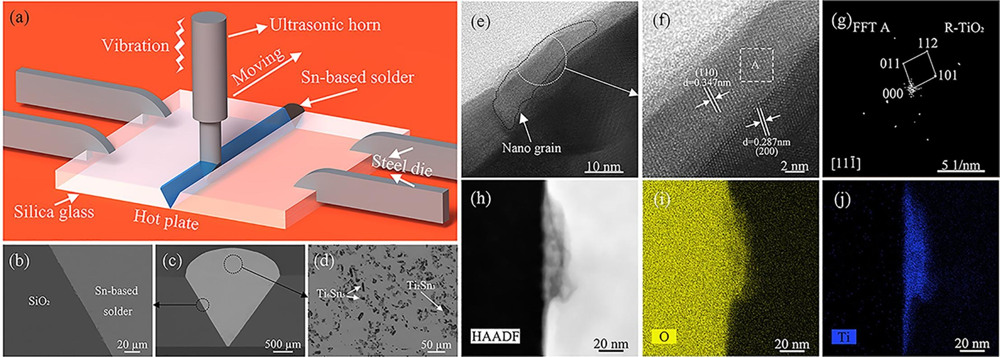
      <a href="https://doi.org/10.1016/j.matlet.2021.131490" class="publication-overlay" target="_blank" rel="noopener">
        View Paper
      </a>
    

    

      

        <a href="https://doi.org/10.1016/j.matlet.2021.131490" target="_blank" rel="noopener">Bonding mechanism of ultrasonically soldered silica glasses using tin-titanium solder filler</a>
      

      
<strong class="author-highlight">Xiaowei Wu</strong>, Z. Li, Xiaoguo Song, H. Dong, X. Yang, Y. Li, S. Wei, J. Fu

      
Materials Letters, 2022 <a href="https://doi.org/10.1016/j.matlet.2021.131490" target="_blank">[paper]</a>

      
SCI, first author

    

  

  
  

    

      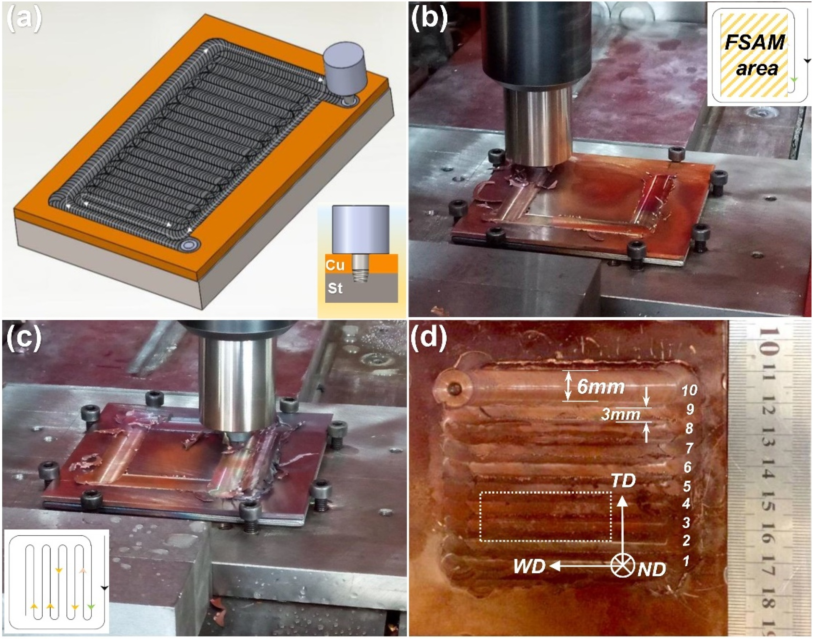
      <a href="https://doi.org/10.1016/j.jmapro.2022.08.022" class="publication-overlay" target="_blank" rel="noopener">
        View Paper
      </a>
    

    

      

        <a href="https://doi.org/10.1016/j.jmapro.2022.08.022" target="_blank" rel="noopener">Microstructure and properties of copper-steel bimetallic sheets prepared by friction stir additive manufacturing</a>
      

      
Y. Guo, <strong class="author-highlight">Xiaowei Wu</strong>, G. Ren, Z. Liu, R. Yuan, X. Yang, Peng Dong

      
Journal of Manufacturing Processes, 2022 <a href="https://doi.org/10.1016/j.jmapro.2022.08.022" target="_blank">[paper]</a>

      
SCI, co-author

    

  

 
<h3 class="section-title">Conference Presentations</h3>

  

    

      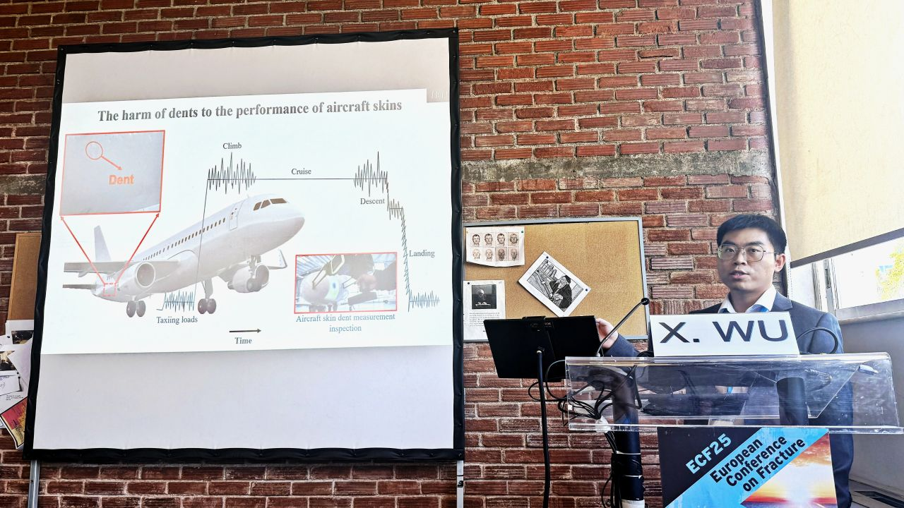
    

    

      

        Interpretable physics-guided CNN for remaining useful life prediction of impact-dented fuselage
      

      
<strong class="author-highlight">Xiaowei Wu</strong>, Sanjay Gothivarekar, Reza Talemi

      
25th European Conference on Fracture (ECF25)

      
Presentation | Athens, Greece, Sep. 2026 | LIRIAS 4443194

    

  

  

    

      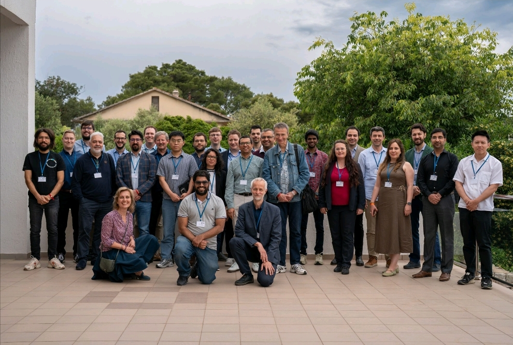
    

    

      

        Physics-informed RUL assessment of impacted aluminum panels using stacking ensemble model
      

      
<strong class="author-highlight">Xiaowei Wu</strong>

      
FABER Conference 2026

      
Presentation | Hvar, Croatia, May 2026 | LIRIAS 4425152

    

  

  

    

      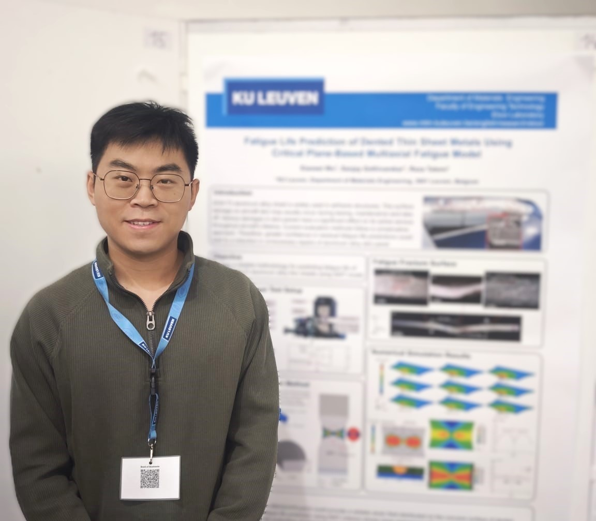
    

    

      

        Fatigue Life Prediction of Dented Thin Sheet Metals Using Critical Plane-Based Multiaxial Fatigue Model
      

      
<strong class="author-highlight">Xiaowei Wu</strong>, Sanjay Gothivarekar, Reza Talemi

      
4th Benelux Damage and Fracture Mechanics Network Meeting (BDFM)

      
Presentation | Antwerp, Belgium, Oct. 2025 | LIRIAS 4405745

    

  

  

    

      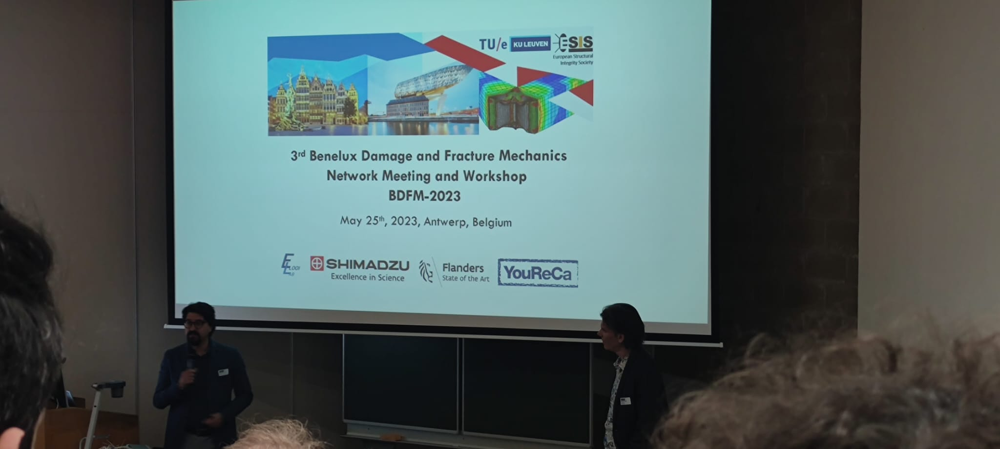
    

    

      

        Fatigue Performance and Remaining Lifetime Prediction of Dented Thin Sheet Metals Using Data Driven Approach
      

      
<strong class="author-highlight">Xiaowei Wu</strong>, Sanjay Gothivarekar, Reza Talemi

      
3rd Benelux Damage and Fracture Mechanics Network Meeting

      
Presentation | Antwerp, Belgium, 2023 | LIRIAS 4263292

    

  

---

## Research Interests

<!-- - ML Systems & AI Infrastructure
- Efficient & On-Device Inference (Apple MLX, [SGLang](https://github.com/sgl-project/sglang))
- Agentic AI (multi-agent orchestration & tool use)
- Machine Learning
- Nonparametric Statistics

I currently work at the intersection of **AI infrastructure and applied ML**, building agent runtimes and optimizing LLM inference.

Previously, my research centered on **nonparametric statistics** and **measurement-error modeling**, unobservable-variable estimation under multiplicative distortion frameworks, where I developed calibration methods and simulation studies to improve correlation-coefficient estimation in complex industrial settings, resulting in five SCI publications.
 -->
- Fatigue & Fracture Mechanics
- Computational Mechanics (Finite-Element Analysis, Abaqus)
- Data-Driven Assessment (Machine Learning, Ensemble Learning, Gaussian Process)
- 3D Surface Metrology & Digital Image Correlation (DIC)
- Dissimilar-Material Processing & Interfacial Characterisation

I currently work at the intersection of **structural integrity, computational mechanics, and applied machine learning**. I build data-driven frameworks and finite-element models to assess residual stress and predict the remaining useful life (RUL) of impact-dented thin sheet structures.

Previously, my research centered on **ultrasonic-assisted active-metal soldering** and **dissimilar-material processing**. I investigated interfacial bonding mechanisms, developed advanced heat-treatment routes, and conducted extensive microstructural characterisations (SEM, EBSD, XRD) for structural composite materials, resulting in six journal publications and a granted patent.
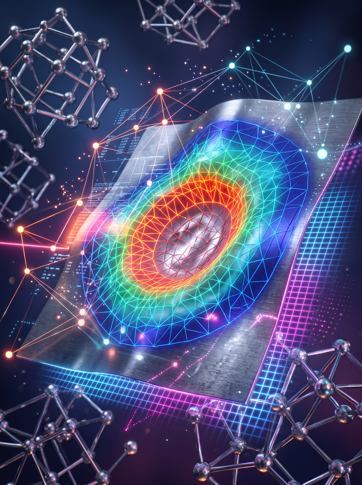
---

## News and Updates

  

    

      September 2026
      Milestone
    

    
Presenting our research on interpretable physics-guided CNNs for remaining useful life prediction of impact-dented fuselage at the <strong>25th European Conference on Fracture (ECF25)</strong> in Athens, Greece.

    

      <figure class="mtile">
        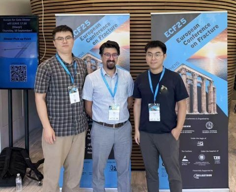
      </figure>

      <!-- ECF25 Conference cover -->
      <a class="mtile mtile--link mtile--contain" href="https://www.ecf25.eu/en" target="_blank" rel="noopener noreferrer" aria-label="ECF25 Official Website (opens in a new tab)">
        
        
          <svg viewBox="0 0 24 24" fill="none" stroke="currentColor" stroke-width="2.2" stroke-linecap="round" stroke-linejoin="round"><path d="M7 17 17 7"/><path d="M8 7h9v9"/></svg>
        
        
          ECF25 Conference
          ecf25.eu
        
      </a>

      <!-- KU Leuven Elooi Lab cover -->
      <a class="mtile mtile--link" href="https://www.ecf25.eu/en/program" target="_blank" rel="noopener noreferrer" aria-label="KU Leuven Elooi Lab (opens in a new tab)">
        
        
          <svg viewBox="0 0 24 24" fill="none" stroke="currentColor" stroke-width="2.2" stroke-linecap="round" stroke-linejoin="round"><path d="M7 17 17 7"/><path d="M8 7h9v9"/></svg>
        
        
          Elooi Lab
          kuleuven.be
        
      </a>
    

  

  

    

      2026
      Publication
    

    
First-Author Paper: <a href="https://doi.org/10.1016/j.ijfatigue.2026.109837"><strong>Inspection-driven remaining useful life prediction of dented thin plates using a stacking ensemble with physics-based validation</strong></a> published in <a href="https://www.sciencedirect.com/journal/international-journal-of-fatigue">International Journal of Fatigue</a>.

  

  

    

      2026
      Publication
    

    
First-Author Paper: <a href="https://doi.org/10.1016/j.aei.2026.104656"><strong>Quantitative stress assessment of dented fuselage panels through the integration of FEM, parametric modeling and Gaussian process regression</strong></a> published in <a href="https://www.sciencedirect.com/journal/advanced-engineering-informatics">Advanced Engineering Informatics</a>.

  

  

    

      March 2023
      Milestone
    

    
Excited to join the <a href="https://www.mtm.kuleuven.be/english/research/elooi"><strong>Metal Performance Innovation (Elooi) Laboratory</strong></a> at <strong>KU Leuven</strong> as a Ph.D. Candidate under the supervision of Prof. Reza Talemi!

  

  

    

      2022
      Publication
    

    
First-Author Paper: <a href="https://doi.org/10.1016/j.matlet.2021.131490"><strong>Bonding mechanism of ultrasonically soldered silica glasses using tin-titanium solder filler</strong></a> published in <a href="https://www.sciencedirect.com/journal/materials-letters">Materials Letters</a>.

  

  
  

    

      May 2020
      Milestone
    

    
Patent Granted! Our invention on <a href="#">Fe-Cu-HEA high-strength, high-toughness biomimetic composite material</a> is officially granted (CN109016728B).

  

<script>
(function() {
  if ('IntersectionObserver' in window) {
    var observer = new IntersectionObserver(function(entries) {
      entries.forEach(function(entry) {
        if (entry.isIntersecting) {
          entry.target.classList.add('animate-in');
          observer.unobserve(entry.target);
        }
      });
    }, { threshold: 0.08, rootMargin: '0px 0px -60px 0px' });
    document.querySelectorAll('.news-card').forEach(function(card) {
      observer.observe(card);
    });
  } else {
    document.querySelectorAll('.news-card').forEach(function(card) {
      card.classList.add('animate-in');
    });
  }
})();

